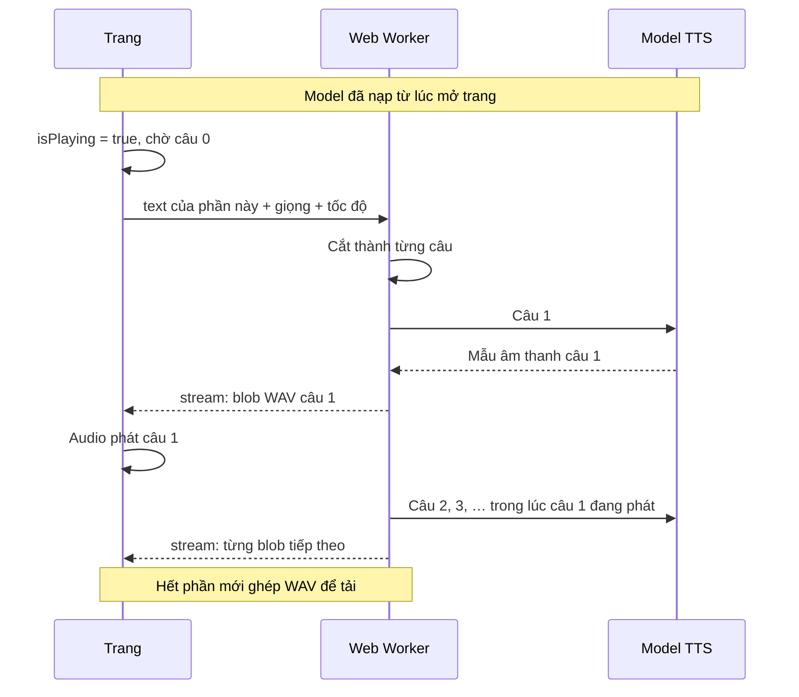

# Tạo audio phần này — vì sao bấm vài giây là nghe được

Pattern đang chạy trong Local-TTS, viết để mang sang dự án khác. Giữ đúng bốn quy tắc dưới đây thì thời gian tới tiếng đầu tiên chỉ bằng một câu, không phải cả chương.

Độ trễ cảm nhận được = thời gian tổng hợp câu đầu tiên trên model đã ấm. Phần còn lại chạy chồng lên thời gian phát. Nút nghe phát câu đó ngay. Nút tải WAV chỉ có file sau khi hết phần, nên chậm hơn; người nghe không cần file đó.

## Bốn quy tắc

1. Nạp model một lần, giữ session ngoài luồng UI. Lần bấm sau không khởi tạo lại.
2. Đơn vị phát là một câu, không phải cả đoạn. Trả audio ngay khi câu đó xong.
3. Bật trạng thái đang phát trước, rồi cắm blob vào player theo thứ tự. Đừng đợi mảng audio đầy.
4. File tải là việc riêng, ghép sau khi hết đoạn.

## Trước lúc bấm

Hai việc đã xong từ lúc mở trang và lúc có bản dịch:

1. **Model đã được nạp.** Một Web Worker tạo session ONNX (WASM SIMD) và giữ nó sống. File `.onnx` nằm trong IndexedDB, nên lần sau không tải lại. Model tạo bằng `PiperTTS.from_pretrained` lúc nhận `{ type: 'init' }`, rồi giữ biến `tts` trong worker. Mọi lần bấm sau dùng lại session đó.
2. **Phần chữ đã cắt sẵn.** Server cắt bản dịch thành `listen/0001.txt`, `0002.txt`, … Mỗi phần khoảng 1.500 từ, cắt theo đoạn văn trống, không cắt giữa đoạn. Một lần bấm chỉ gửi phần đang mở.

## Hai tầng cắt

| Tầng | Chỗ cắt | Kích thước | Mục đích |
|---|---|---|---|
| Phần nghe | Server, theo đoạn văn trống | ~1.500 từ | Một lần bấm không nuốt cả chương |
| Câu | Worker, theo `.` `!` `?` | một câu | Một lần chạy model đủ ngắn để có tiếng trong vài giây |

Câu ngắn thì một lần chạy model xong trước khi người nghe kịp nhận ra độ trễ. Trong lúc câu đó phát (vài giây), worker đã làm các câu sau, nên sau tiếng đầu gần như không bị ngắt — miễn là thời gian tổng hợp câu sau ngắn hơn thời gian phát câu trước.

Không gộp câu. Dấu phẩy nằm trong câu. Chỉ tách khi gặp `.` `!` `?`.

```js
const sentences = line.split(/(?<=[.!?])(?=\s+|$)/);
```

Một phần ~1.500 từ thành vài chục câu. Câu đầu thường ngắn, nên lần `session.run` đầu xong trong vài giây.

## Luồng khi bấm

Worker tách phần theo `.` `!` `?`. Mỗi câu là một lần `session.run`. Câu 1 xong thì `postMessage` một blob WAV; trang gắn blob vào `<audio>` và `play()`.



## Hợp đồng giữa trang và worker

Trang gửi một message, không gửi cả sách:

```js
worker.postMessage({
  text,          // chỉ phần đang mở
  voice,         // id giọng
  speed,         // tốc độ đọc
  token,         // số tăng mỗi lần bấm, để bỏ kết quả của lần bấm cũ
});
```

Worker trả bốn loại message:

| status | Khi nào | Payload |
|---|---|---|
| `ready` | Model nạp xong, trước khi ai bấm | danh sách giọng |
| `stream` | Mỗi câu xong | `{ token, chunk: { audio: Blob, text } }` |
| `complete` | Hết phần, WAV đã ghép | `{ token, audio: Blob }` |
| `error` | Lỗi | `{ token, data }` |

Trang bỏ mọi `stream` / `complete` / `error` có `token` khác lần bấm hiện tại. Bấm lại hoặc đổi phần thì tăng `token` (và tăng một bộ đếm trong worker) để lần chạy cũ tự dừng, không đè audio mới.

## Trang

Bật phát trước khi có audio. `currentChunkIndex` trỏ câu 0 dù blob chưa tới.

```js
function startPlayback() {
  if (!text.value || !worker.value) return;
  status.value = 'generating';
  chunks.value = [];
  isPlaying.value = true;
  currentChunkIndex.value = 0;   // câu 0, dù blob chưa tới
  const token = ++playToken;
  worker.value.postMessage({
    text: text.value,
    voice: selectedVoice.value,
    speed: speed.value,
    token,
  });
}
```

Khi message `stream` tới, nối blob vào danh sách:

```js
case 'stream': {
  chunks.value = [...chunks.value, data.chunk];
  break;
}
```

Mỗi blob là một `<audio>` ẩn. Phần tử nào có `active` (đúng `currentChunkIndex`) và `playing` thì `play()`. Câu sau chưa có thì index cứ tiến; khi blob tới, phần tử mới được mount và phát. Hết một câu thì tăng index và nhớ câu đó để lần sau nghe tiếp.

`complete` chỉ để bật nút tải. Nếu đang phát mà index đã vượt quá số câu có sẵn, coi như hết phần.

## Worker

Trả từng câu. Ghép file chỉ sau khi hết phần. `tts.stream` với mỗi câu đi chữ → phoneme → id → một lần `session.run` → `Float32Array`. Không gom câu lại rồi chạy một lần.

```js
const streamer = new TextSplitterStream();
await streamer.push(text);   // làm sạch + cắt câu
streamer.close();

const chunks = [];
for await (const { text, audio } of tts.stream(streamer, { speakerId, lengthScale })) {
  if (current !== run) return;          // lần bấm mới đã thay
  self.postMessage({
    status: 'stream',
    token,
    chunk: { audio: audio.toBlob(), text },
  });
  chunks.push(audio);
}

// Chỉ lúc này mới ghép Float32Array thành một WAV cho nút tải
self.postMessage({ status: 'complete', token, audio: merged.toBlob() });
```

## Những chỗ dễ làm chậm lại

- Đợi `complete` rồi mới `play()`. Đó là nuốt cả phần trước khi có tiếng.
- Tạo session ONNX trong lần bấm. Nạp model lúc mở trang, giữ worker sống.
- Nhét cả sách vào một lần `session.run`. Cắt phần ở server, cắt câu ở worker.
- Ghép WAV trên luồng UI trước khi phát. Ghép là việc của nút tải.
- Không có `token` / bộ đếm hủy. Lần bấm cũ sẽ trả audio đè lên lần mới.

## File gốc trong Local-TTS

| Việc | File |
|---|---|
| Nút, trạng thái phát, nhận từng câu | `src/views/WorkflowView.vue` (`startPlayback`, `onMessageReceived`) |
| `<audio>` phát đúng câu đang active | `src/components/AudioChunk.vue` |
| Cắt câu, chạy ONNX, trả blob, ghép WAV | `src/workers/tts-worker.js` |
| Session ONNX và `stream()` từng câu | `src/lib/piper-tts.js` |
| Cắt ~1.500 từ thành `listen/NNNN.txt` | `pipeline/server.py` (`_split_listen`) |
| Cache file model | `src/utils/model-cache.js` |
